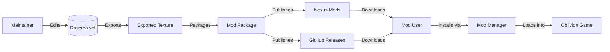
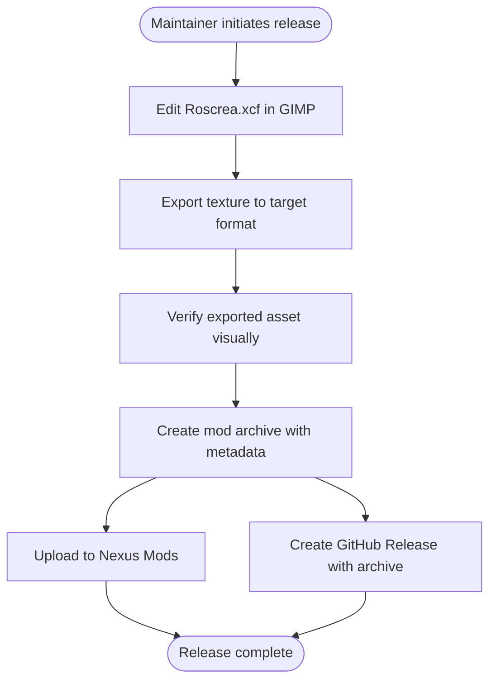
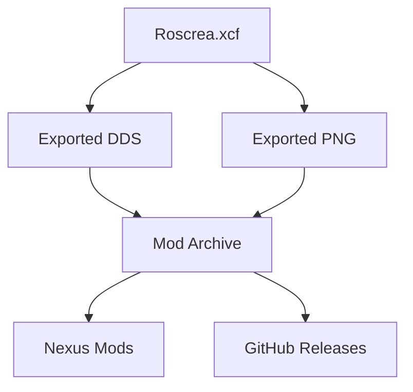

# TES Map - Roscrea Architecture

This document describes the current architecture of the TES Map - Roscrea project, a static map artwork asset for The Elder Scrolls IV: Oblivion modding. It covers the asset structure, distribution model, and maintenance boundaries.

## 📑 Table of Contents

- [Purpose](#-purpose)
- [System Context](#-system-context)
- [Architectural Style](#-architectural-style)
- [Runtime Flow](#-runtime-flow)
- [Architectural Areas](#-architectural-areas)
- [Data Architecture](#-data-architecture)
- [Interfaces and Integrations](#-interfaces-and-integrations)
- [Cross-Cutting Concerns](#-cross-cutting-concerns)
- [Dependency Direction and Rules](#-dependency-direction-and-rules)
- [External Dependencies](#-external-dependencies)
- [Deployment and Operations](#-deployment-and-operations)
- [Compatibility Contracts](#-compatibility-contracts)
- [Testing and Verification](#-testing-and-verification)
- [Design Constraints](#-design-constraints)
- [Extension Points](#-extension-points)
- [Related Documentation](#-related-documentation)

## 🎯 Purpose

This document defines the architectural boundaries of the TES Map - Roscrea project. The project is a single-source artwork asset (Roscrea.xcf) distributed as a mod for The Elder Scrolls IV: Oblivion. The architecture describes the asset lifecycle from source editing through export, packaging, and distribution. The intended audience is maintainers and contributors who modify the map artwork or manage its distribution.

## 🌐 System Context

The project is a content-only repository with no runtime component. The system boundary encompasses the source XCF file, exported texture assets, and distribution packaging. External actors are the maintainer (editing and releasing), mod users (installing via mod manager), and distribution platforms (Nexus Mods, GitHub Releases).



The principal external boundaries are:
- **Source Editor (GIMP):** Authoring environment for the XCF source file; reads and writes Roscrea.xcf
- **Export Pipeline:** Maintainer-driven process producing game-ready texture formats from the XCF source
- **Nexus Mods:** Primary distribution channel; hosts the packaged mod archive
- **GitHub Releases:** Secondary distribution channel; hosts the packaged mod archive and source
- **Mod Manager:** User-side tool that stages and enables the mod package for Oblivion
- **Oblivion Game:** Target host application; consumes the exported texture at runtime

## 🏗️ Architectural Style

The project follows a **single-source asset pipeline** style: one authoritative source file (XCF) drives all downstream artefacts through a manual export-and-package process. This style is typical for game mod assets where the source format preserves editing flexibility (layers, masks, non-destructive adjustments) while the runtime format is a flattened, optimised texture.

```mermaid
flowchart TD
    Source[Roscrea.xcf\n(Authoritative Source)] --> Export[Manual Export\n(GIMP)]
    Export --> Texture[Exported Texture\n(DDS/PNG/TGA)]
    Texture --> Package[Mod Package\n(Archive + Metadata)]
    Package --> Nexus[Nexus Mods]
    Package --> GitHub[GitHub Releases]
```

The principal architecture boundaries are:
- **Source Layer:** Roscrea.xcf — sole authoritative representation; all edits occur here
- **Export Boundary:** Manual, maintainer-driven; no automated build pipeline
- **Distribution Layer:** Packaged archives on Nexus Mods and GitHub Releases; immutable once published

## 🔄 Runtime Flow

The project has no runtime execution flow. The closest analogue is the **release flow** executed by the maintainer:



The principal release sequence is:
1. Maintainer edits Roscrea.xcf in GIMP on separate layers
2. Maintainer exports the final texture in the target format required by the mod package
3. Maintainer verifies the exported asset visually
4. Maintainer creates the mod archive with required metadata (descriptor files, folder structure)
5. Maintainer publishes the archive to Nexus Mods and creates a GitHub Release

## 🗂️ Architectural Areas

### Source Asset

Paths:
- `Roscrea.xcf`

Responsibilities:
- Authoritative source for all map artwork
- Preserves layer structure, masks, and non-destructive edits
- Single source of truth for the map composition

Boundary rules:
- All visual modifications must be made in Roscrea.xcf
- Exported textures are derived artefacts; do not edit them directly
- Layer organisation should remain practical for future edits

### Distribution Packaging

Paths:
- Release archives on Nexus Mods and GitHub Releases (not in repository)

Responsibilities:
- Package exported textures into Oblivion-compatible mod structure
- Include metadata required by mod managers (descriptor files, version info)
- Ensure archive structure matches Oblivion mod expectations

Boundary rules:
- Package contents are derived from exported textures only
- No source files (XCF) included in distribution packages
- Version numbering follows semantic versioning aligned with Git tags

### Documentation

Paths:
- `README.md`
- `CONTRIBUTING.md`
- `SECURITY.md`
- `PRIVACY.md`
- `CODE_OF_CONDUCT.md`
- `LICENSE`
- `ARCHITECTURE.md`

Responsibilities:
- Communicate project purpose, usage, and contribution guidelines
- Define security, privacy, and conduct policies
- Record architectural decisions and boundaries

Boundary rules:
- Documentation must remain synchronised with the actual asset and distribution state
- Security and privacy statements reflect the static-asset nature of the project

## 💾 Data Architecture

The project manages a single primary data asset with derived representations:

```mermaid
flowchart LR
    XCF[Roscrea.xcf\n(GIMP native,\nlayered, lossless)] -->|Manual Export| DDS[DDS Texture\n(BC compressed,\nmipmapped)]
    XCF -->|Manual Export| PNG[PNG Texture\n(lossless,\nreference)]
    DDS -->|Packaged| ModArchive[Mod Archive\n(zip/7z)]
    PNG -->|Packaged| ModArchive
```

| Data or Store | Owner | Representation and Storage | Lifecycle or Consistency |
|---------------|-------|----------------------------|--------------------------|
| `Roscrea.xcf` | Maintainer | GIMP XCF (layered, lossless) in repository root | Authoritative; modified only by maintainer; versioned in Git |
| `Exported DDS` | Maintainer | BC-compressed DDS with mipmaps (game runtime format) | Derived; created on each release; not versioned in Git |
| `Exported PNG` | Maintainer | Lossless PNG (reference/archival format) | Derived; created on each release; not versioned in Git |
| `Mod Archive` | Maintainer | Zip/7z archive with Oblivion mod folder structure | Derived; published to Nexus Mods and GitHub Releases; immutable once published |

## 🔌 Interfaces and Integrations

| Interface or Integration | Direction | Contract | Owner | Failure Semantics |
|--------------------------|-----------|----------|-------|-------------------|
| `GIMP XCF Format` | Inbound (read/write) | GIMP 2.10+ XCF specification | Maintainer | Source corruption prevents editing; recover from Git history |
| `Oblivion Texture Format (DDS)` | Outbound (write) | DDS with BC compression, mipmaps, correct dimensions | Maintainer | Invalid format causes visual artefacts or load failure in-game |
| `Nexus Mods API/Upload` | Outbound (publish) | Nexus Mods mod submission format (archive + metadata) | Maintainer | Upload failure blocks distribution; retry manually |
| `GitHub Releases` | Outbound (publish) | GitHub Release with attached archive | Maintainer | Release creation failure blocks secondary distribution; retry manually |
| `Mod Manager (MO2, Vortex, etc.)` | Inbound (consumption) | Oblivion mod archive structure (BAIN or FOMOD) | Mod User | Incorrect structure prevents installation; fix archive layout |

## 🧵 Cross-Cutting Concerns

### Security and Privacy

The project has no runtime attack surface. Security concerns are limited to:
- **Supply-chain integrity:** Ensuring distributed archives match the maintainer's intended release (addressed by SECURITY.md)
- **Licence compliance:** GPL v3 applies to the artwork; downstream modifications must respect copyleft
- **No personal data:** The asset contains no personal data, telemetry, or network communication

### Error Handling

- **Source corruption:** Recover Roscrea.xcf from Git history
- **Export failure:** Re-export from XCF; verify GIMP version compatibility
- **Packaging error:** Recreate archive with correct folder structure
- **Distribution failure:** Retry upload; verify platform status

### Observability

No automated observability. Maintainer manually verifies:
- Visual correctness of exported textures
- Successful upload to Nexus Mods and GitHub Releases
- Mod installs and loads correctly in Oblivion via mod manager

### Configuration

No runtime configuration. Build-time choices (export format, compression, mipmap settings) are documented in the Development section of README.md and applied manually during export.

### Concurrency and Resource Use

No concurrency. Single-maintainer workflow. Resource use is limited to GIMP memory during editing and export.

## 🧭 Dependency Direction and Rules



The principal dependency rules are:
- **Source owns derivatives:** Roscrea.xcf is the sole authoritative source; all exported textures and packages derive from it
- **No reverse dependency:** Exported textures and packages never modify the source
- **Distribution is terminal:** Published archives are immutable; updates require a new release cycle from source
- **Tooling independence:** GIMP is the designated editor; no build scripts or CI pipelines automate export

## 📦 External Dependencies

| Dependency | Responsibility | Integration Boundary | Architectural Consequence |
|------------|----------------|----------------------|---------------------------|
| `GIMP` | Source editing and export | Maintainer's local environment | Version drift may affect XCF compatibility or export options; document required version in README |
| `Oblivion` | Target runtime | Mod user's game installation | Texture format requirements (DDS, BC compression, mipmaps, dimensions) are dictated by Oblivion engine |
| `Nexus Mods` | Primary distribution | Maintainer's account | Platform policies govern content, versioning, and takedown; no technical API dependency |
| `GitHub` | Secondary distribution and source hosting | Repository and Releases | Git for source history; Releases for archive hosting; no runtime dependency |

## 🚀 Deployment and Operations

| Concern | Current Design | Architectural Consequence |
|---------|----------------|---------------------------|
| **Process topology** | Single-maintainer manual workflow | No automation; release velocity limited by maintainer availability |
| **Deployment unit** | Mod archive (zip/7z) containing DDS texture(s) and metadata | Immutable once published; updates require new version |
| **Persistent state** | Git repository (source + docs); Nexus Mods and GitHub Releases (archives) | Source history in Git; distribution history on platforms |
| **Filesystem requirements** | Oblivion mod directory structure (textures/ folder) | Archive must mirror expected mod layout for mod managers |
| **Scaling assumptions** | Not applicable (static content) | No horizontal scaling; distribution platforms handle bandwidth |
| **Startup/shutdown** | Not applicable | No service lifecycle |
| **Operator-visible outputs** | Nexus Mods page, GitHub Release page, in-game map | Maintainer verifies visual result in-game after release |

## 🛡️ Compatibility Contracts

| Contract | Owner | Invariant | Verification | Change Policy |
|----------|-------|-----------|--------------|---------------|
| `Oblivion Texture Format` | Maintainer | DDS with BC compression, mipmaps, power-of-two dimensions matching original map size | Visual verification in-game; mod manager validation | Backward compatible only; breaking changes require new mod version |
| `Mod Archive Structure` | Maintainer | BAIN/FOMOD-compatible folder layout (textures/maps/ or equivalent) | Mod manager installation test | Additive only; restructuring requires major version |
| `GPL v3 Licence` | Maintainer | Copyleft applies to artwork and derivative works | Licence file in repository; source (XCF) available | Irrevocable; cannot be changed retroactively |
| `Nexus Mods Metadata` | Maintainer | Correct version, category, game version, dependencies fields | Nexus Mods validation on upload | Platform-dictated; adapt to platform changes |

## ✅ Testing and Verification

No automated test suite exists. Verification is manual and performed by the maintainer during each release:

1. **Visual verification:** Open exported texture in image viewer; compare against XCF source for fidelity
2. **In-game verification:** Install mod via mod manager; launch Oblivion; confirm map displays correctly
3. **Archive validation:** Verify mod manager installs package without errors
4. **Distribution verification:** Confirm Nexus Mods and GitHub Releases show correct version and downloadable archive

Execute the principal manual verification with:

```bash
# No automated commands. Manual steps:
# 1. Open Roscrea.xcf in GIMP
# 2. Export to target DDS format
# 3. Create mod archive with correct folder structure
# 4. Install via mod manager (MO2, Vortex, etc.)
# 5. Launch Oblivion and verify map appearance
# 6. Upload archive to Nexus Mods
# 7. Create GitHub Release with archive attached
```

## ⚠️ Design Constraints

- **Single-source constraint:** All edits must go through Roscrea.xcf; no direct editing of exported textures
- **Manual pipeline:** No CI/CD, no automated export, no automated packaging; human-driven release process
- **Format lock-in:** Oblivion requires DDS with specific compression and mipmap settings; alternative formats not supported by game engine
- **Distribution platform dependence:** Nexus Mods is primary channel; GitHub Releases is secondary; both are external platforms with their own policies
- **No runtime extensibility:** The asset is static; no plugin system, no scripting, no configuration at runtime
- **GPL v3 copyleft:** Derivative works must be licensed under GPL v3 or later; source (XCF) must be made available

## 🔌 Extension Points

The project intentionally exposes no extension points. It is a finished artwork asset, not a platform. Potential extension by downstream users occurs through:
- **Forking the repository:** Full copy of source and history; independent maintenance
- **Modifying the XCF:** Direct edits to Roscrea.xcf in a fork
- **Creating derivative mods:** Using exported textures as base for new mods (subject to GPL v3)

No stable interfaces, hooks, or composition boundaries exist for third-party extension within this repository.

## 📚 Related Documentation

| Document | Scope |
|----------|-------|
| `README.md` | Project overview, usage, installation, development setup |
| `CONTRIBUTING.md` | Contribution guidelines, pull request process, code style |
| `SECURITY.md` | Security policy, supported versions, vulnerability reporting, disclosure |
| `PRIVACY.md` | Privacy statement (static asset, no data collection) |
| `CODE_OF_CONDUCT.md` | Community conduct standards |
| `LICENSE` | GNU General Public License v3.0 full text |